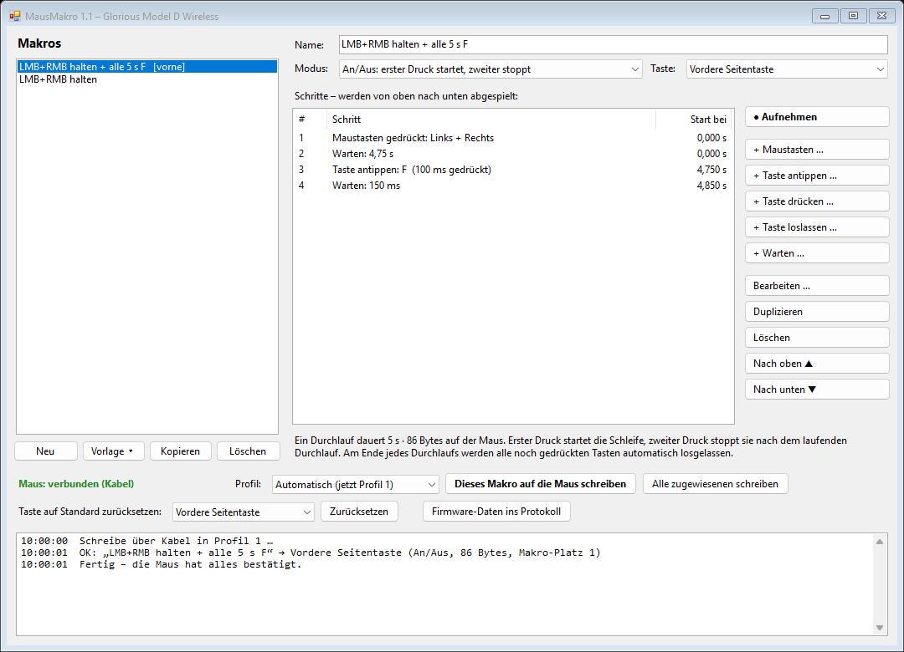
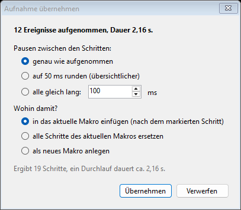

# MausMakro

Makro-Editor für die **Glorious Model D Wireless**. Makros werden aus einfachen Schritten zusammengeklickt,
direkt in den Speicher der Maus geschrieben und auf eine Taste gelegt – Glorious Core wird dafür nicht gebraucht.
Weil die Makros in der Maus-Firmware laufen, kommen sie auch in Spielen an, die künstliche Eingaben
(SendInput, AutoHotkey usw.) ignorieren.

Im Gegensatz zu Glorious Core kann MausMakro **mehrere Maustasten gleichzeitig gedrückt halten**
(z. B. Links + Rechts) und Maus- und Tastaturaktionen frei mischen.

## Funktionen

- Schritte: **Maustasten** (Links, Rechts, Mitte, Zurück, Vor – beliebig kombiniert), **Taste antippen**,
  **Taste drücken**, **Taste loslassen**, **Warten**
- **Aufnahme:** Tasten und Maustasten einfach vormachen – mit echten Pausen, auch in anderen Fenstern
- Tasten per Tastendruck aufnehmen oder aus einer Liste wählen (inkl. Strg, Umschalt, Alt, Win, Ziffernblock)
- Modus je Makro: **Einmal abspielen**, **Wiederholen, solange die Taste gedrückt ist**, **An/Aus**
- Belegbare Tasten: vordere Seitentaste, hintere Seitentaste, Mausrad-Klick, DPI-Taste
- Tasten wieder auf ihre **Standardfunktion zurücksetzen**
- Vorlagen, z. B. „LMB + RMB halten“, „LMB + RMB halten + alle 5 s F“, „Dauerklick links“
- Makros werden automatisch gespeichert (`%APPDATA%\MausMakro\makros.json`)
- Funktioniert per Kabel und über den Funk-Empfänger

## Download

Die fertige `MausMakro.exe` gibt es unter [Releases](../../releases). Keine Installation nötig,
benötigt wird nur das .NET Framework 4.8 (ist in Windows 10/11 enthalten).

Da die EXE nicht signiert ist, zeigt Windows SmartScreen beim ersten Start eventuell eine Warnung
(„Weitere Informationen“ → „Trotzdem ausführen“). Wer das nicht möchte, baut das Programm einfach selbst.

## Selbst bauen

`build.cmd` ausführen. Verwendet wird der C#-Compiler, der bei Windows ohnehin dabei ist
(`%WINDIR%\Microsoft.NET\Framework64\v4.0.30319\csc.exe`) – kein Visual Studio, kein .NET-SDK nötig.
Der Quelltext ist deshalb bewusst C# 5 und steckt komplett in `MausMakro.cs`.

## Benutzung

1. Links ein Makro anlegen (**Neu** oder **Vorlage**).
2. Rechts die Schritte hinzufügen. Beispiel „Links + Rechts halten und alle 5 Sekunden F drücken“:
   - Maustasten gedrückt: Links + Rechts
   - Warten: 4750 ms
   - Taste antippen: F (100 ms)
   - Warten: 150 ms
3. **Modus** und **Taste** wählen.
4. **Dieses Makro auf die Maus schreiben** klicken.

### Aufnehmen

Statt Schritte einzeln hinzuzufügen, kann man sie auch vormachen:

1. Rechts auf **● Aufnehmen** klicken.
2. Tasten und Maustasten drücken – das funktioniert auch, während ein anderes Fenster im Vordergrund ist.
   Gleichzeitig gedrückte Maustasten (z. B. Links + Rechts) werden als Kombination erkannt.
3. Mit **F12** (oder einem Klick auf **■ Stopp**) beenden.
4. Im folgenden Fenster wählen, ob die Pausen genau übernommen, auf 50 ms gerundet oder alle gleich lang
   werden sollen – und ob die Aufnahme eingefügt, das Makro ersetzt oder ein neues Makro angelegt wird.

Danach steht die Aufnahme als normale Schrittliste da und kann bearbeitet werden. Kurzes Drücken und
Loslassen einer Taste wird automatisch zu „Taste antippen“ zusammengefasst.

Gut zu wissen:
- **Mausbewegungen und Mausrad** werden nicht aufgenommen – die Maus-Firmware kennt in Makros nur Tasten und Pausen.
- Auch Klicks oder Alt+Tab zum Fensterwechsel landen in der Aufnahme; solche Schritte danach einfach löschen.
- Läuft ein Spiel mit Administratorrechten, sieht MausMakro dessen Eingaben eventuell nicht.
  Am sichersten außerhalb des Spiels aufnehmen (z. B. auf dem Desktop).
- Künstlich erzeugte Eingaben (z. B. von AutoHotkey) werden ignoriert.

### Was beim Abspielen passiert

Am Ende jedes Durchlaufs lässt MausMakro automatisch alle noch gedrückten Tasten los – sonst blieben sie nach
dem Ausschalten des Makros hängen. Im Modus *An/Aus* stoppt das Makro nach dem laufenden Durchlauf.

## Hinweise

- **Glorious Core:** Wird dort eine Tastenbelegung geändert, überschreibt Glorious Core alle Belegungen der Maus.
  Danach in MausMakro einfach **Alle zugewiesenen schreiben** klicken.
- Getestet mit der **Model D Wireless** (USB-VID `258A`, PID `2012` Kabel / `2023` Empfänger). Andere
  Glorious-Mäuse werden nicht erkannt.
- Wie lang ein Makro höchstens sein darf, ist nicht bekannt. Ab ca. 1000 Bytes zeigt das Programm eine Warnung.
- Inoffizielles Projekt, nicht mit Glorious verbunden. Benutzung auf eigene Gefahr. Ob Makros in einem Spiel
  erlaubt sind, regeln dessen Nutzungsbedingungen.

## Protokoll

Für alle, die selbst etwas bauen möchten – das Format stammt aus Glorious Core. Alle Befehle sind
Feature-Reports (Report-ID 0, 65 Bytes) an die Herstellerschnittstelle (Usage Page `FFFF`, Usage `00`).
Die Maus bestätigt mit `A1` (`A0` = beschäftigt, `A2` = fehlgeschlagen, `A4` = Empfänger findet die Maus nicht).

| Befehl | Bytes |
|---|---|
| Makro löschen | `00 00 00 02 02 04 02 idHi idLo` |
| Makrolänge setzen | `00 00 00 02 06 04 01 idHi idLo 00 00 lenHi lenLo` |
| Makrodaten (je 51 Bytes) | `00 00 00 02 3A 04 03 idHi idLo 00 00 offHi offLo 33 <Daten>` |
| Taste belegen | `00 00 00 02 0A 03 00 <Profil> <Taste> 00 <Funktion>` |

- Tasten-IDs: Links `01`, Rechts `02`, Mitte `03`, Zurück `04`, Vor `05`, DPI `14`
- Funktion „Makro“: Einmal `10 03 idHi idLo 01`, solange gedrückt `11 02 idHi idLo 00`, An/Aus `12 02 idHi idLo 00`
- Standardfunktionen: Maustaste `01 01 <Taste>`, DPI-Taste `07 01 06`

Makrodaten bestehen aus Ereignissen mit je zwei Bytes:

| Ereignis | Bytes |
|---|---|
| Maustasten-Zustand (Maske: 1 L, 2 R, 4 M, 8 Zurück, 16 Vor) | `01 <Maske>` |
| Taste drücken / loslassen (HID-Usage) | `02 <HID>` / `03 <HID>` |
| Strg/Umschalt/Alt/Win drücken / loslassen (Bit) | `09 <Bit>` / `0A <Bit>` |
| Pause 1–255 ms | `20 <ms>` |

Glorious Core selbst schickt pro Schritt nur eine Maustaste – deshalb kann es keine zwei Tasten gleichzeitig halten.

## Lizenz

[MIT](LICENSE)
